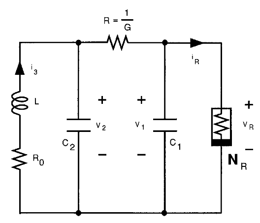
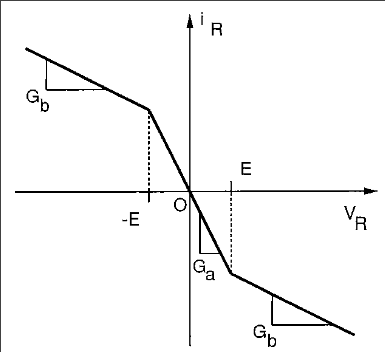

# Chua Oscillator — A Paradigm of Chaos
**References:**  
- Chua L. O., IEICE Trans. Fundamentals E76-A, 704, (1993) [pdf](https://people.eecs.berkeley.edu/~chua/papers/Chua93c.pdf)  
- Galias Z., Positive Topological Entropy of Chua's Circuit: A Computer Assisted Proof. International Journal of Bifurcation and Chaos, 331–349 (1997) [pdf](https://people.eecs.berkeley.edu/~chua/papers/Galias97.pdf)
- Pivka, L., Wu, C.W., Huang, A.: Chua's oscillator: a compendium of chaotic phenomena. J. Franklin Inst. 331, 705–741 (1994) [pdf](https://people.eecs.berkeley.edu/~chua/papers/Pivka94.pdf)
- Matsumoto, T., Chua, L. O., Komuro, M.: The Double Scroll. IEEE Trans. Circuits Syst. 32, 797–818 (1985)

---

## Part I — Theory

### 1. Motivation and Context

- **Goal:** Understand how simple deterministic circuits can exhibit complex, aperiodic, and chaotic dynamics.  
- **Why Chua circuit?**  
  - It is the *simplest physical chaotic oscillator*.  
  - Realizable with simple electronic components.  
  - Ideal for exploring bifurcations, attractors, Lyapunov exponents, and fractal geometry.  

**Key chaotic oscillator families:** Lorenz, Rössler, Duffing, **Chua** — each is a low-dimensional autonomous system. Autonomous systems display time-varying outputs without a time-varying input.

---

### 2. Circuit Description

**Components**
| Symbol | Element | Role |
|---------|----------|------|
| $C_1$ | Capacitor | voltage $v_1$ |
| $C_2$ | Capacitor | voltage $v_2$ |
| $L$  | Inductor  | current $i_3$ |
| $R$  | Resistor  | linear damping |
| $R_0$  | Resistor  | linear damping (inductor losses) |
| $N_R$ | Nonlinear resistor ("Chua diode") | source of nonlinearity |

---

### 3. Governing Equations

Apply Kirchhoff's laws:
1) The sum of all currents in a node is zero
2) The sum of all potential drops within a loop is zero

| Quantity | Expression |
|-----------|---------------|
| Current | $\sum\limits_{l \in \text{Node}} i_l=0$ |
| Voltage | $\sum\limits_{l \in \text{Loop}} v_l=0$ |

We apply the first rule to the two top nodes, and the second one to the loop
containing the inductor $L$, the resistor $R_0$ and the capacitor $C_2$.
Therefore getting the equations:

$$
\begin{aligned}
C_1 \frac{dv_1}{dt} &= \frac{1}{R}(v_2 - v_1) - i_{NR}(v_1), \\
C_2 \frac{dv_2}{dt} &= \frac{1}{R}(v_1 - v_2) + i_3, \\
L \frac{di_3}{dt} &= -v_2-R_0 i_3.
\end{aligned}
$$

The current $i_{NR}(v_1)$ is the current flowing through the non-linear resistor.
In general it can have any form, provided it is a non-linear function of $v_1$.
The easiest form [Chua 1993] is a piecewise linear function.

$$ i_{NR}(v_1) = G_b v_1 + \frac{1}{2}(G_a - G_b)
  \big(|v_1 + E| - |v_1 - E|\big) $$

- $G_a$: inner (negative) slope  
- $G_b$: outer slope  
- $E$: break voltage  

This defines a **three-segment** $I$–$V$ curve.

**WARNING:** Notice the negative response of the system: for $|v_1| < E$ the current flows "in the wrong direction". This is called **negative differential resistance**.

---

### 4. Normalization and Dimensionless Form

Let us introduce dimensionless quantities

| Quantity | Quantity | Quantity |
|-----------|-----------|-----------|
| $x = \frac{v_1}{E}$ | $y = \frac{v_2}{E}$ | $z = \frac{R i_L}{E}$|
| $\alpha=\frac{C_2}{C_1}$| $\beta=\frac{R^2 C_2}{L}$| $\gamma=\frac{R R_0 C_2}{L}$|
| $a=R\,G_a$ | $b=R\,G_b$ | $\tau = \frac{t}{R C_2}$|

Through which we can rewrite the set of equations as:

$$
\begin{aligned}
\frac{dx}{d\tau} &= \alpha (y - x - f(x)), \\
\frac{dy}{d\tau} &= x - y + z, \\
\frac{dz}{d\tau} &= -\beta y -\gamma z,\\
f(x) &= b x + \frac{1}{2} (a-b)(|x + 1| - |x - 1|).
\end{aligned}
$$

The system is **dissipative**: the flow contracts volumes at the instantaneous
rate $\nabla\cdot F = -\alpha(1+f'(x)) - 1 - \gamma$, which is negative on
average along trajectories. Trajectories therefore collapse onto an
**attractor**, unlike the conservative double pendulum whose trajectories
fill energy shells.

**Canonical parameters (double scroll).** Throughout the exercises we use the
classical parameter set of Matsumoto–Chua–Komuro (1985):

$$\alpha = 9,\qquad \beta = \frac{100}{7} \approx 14.286,\qquad \gamma = 0,
\qquad a = -\frac{8}{7},\qquad b = -\frac{5}{7}.$$

---

### 5. Equilibria and Linear Stability

**Fixed points**
We find the fixed points by setting
$\frac{dx}{d\tau}=0$, $\frac{dy}{d\tau}=0$, $\frac{dz}{d\tau}=0$.

From the third equation $z = -\frac{\beta}{\gamma} y$ (for $\gamma \neq 0$;
for $\gamma=0$ the same conclusion follows by taking the limit carefully),
and substituting into the second, $z = y - x$, gives

$$
y = \frac{\gamma}{\beta+\gamma}\,x,\qquad
z = -\frac{\beta}{\beta+\gamma}\,x .
$$

Together with the first equation, $y = x + f(x)$, this determines the
equilibria. In the central region ($f(x)=ax$) only the origin survives:

$$ P_0 = (0,0,0). $$

In each outer region ($f(x) = bx \pm (a-b)$, with slope $b$) the equilibrium is

$$
P_\pm = \left( x^{\pm},\ \frac{\gamma x^{\pm}}{\beta+\gamma},\
-\frac{\beta x^{\pm}}{\beta+\gamma} \right),
\qquad
x^{\pm}=\pm\frac{(b-a)(\gamma+\beta)}{\beta + b(\gamma+\beta)} .
$$

Note that $(y^{\ast},z^{\ast})$ are **proportional to** $x^{\pm}$ — a common
error is to state them as the constants $\gamma/(\beta+\gamma)$ and
$-\beta/(\beta+\gamma)$, which hold only if $x^{\ast}=\pm 1$.

For the canonical parameters the two outer equilibria are exactly

$$ P_\pm = (\pm 1.5,\ 0,\ \mp 1.5). $$

The outer equilibria exist **only if** they indeed lie in the outer region,
i.e. for $\pm x^{\pm} > \pm 1$.

**Stability**
To study the stability of the fixed points we compute the Jacobian of the
system, where $m = f'(x^{\ast})$ is the slope ($a$ or $b$) of the region the
fixed point lies in:

$$
J =
\begin{pmatrix}
-\alpha(1+f'(x^\ast)) & \alpha & 0 \\
1 & -1 & 1 \\
0 & -\beta & -\gamma
\end{pmatrix}
$$

The characteristic polynomial $\det(\lambda I - J) =
\lambda^3 + c_2\lambda^2 + c_1\lambda + c_0$ has the closed forms

$$
c_2 = \gamma + 1 + \alpha(1+m),\qquad
c_1 = \gamma + \beta + \alpha(1+m)(\gamma+1) - \alpha,\qquad
c_0 = \alpha\big[(1+m)(\gamma+\beta) - \gamma\big].
$$

A linearization is stable iff all eigenvalues have negative real part, which
by the **Routh–Hurwitz criterion** for a cubic requires

$$ c_2 > 0,\qquad c_0 > 0,\qquad c_1 c_2 > c_0. $$

The boundary $c_1 c_2 = c_0$ is a **Hopf bifurcation**: a complex eigenvalue
pair crosses the imaginary axis, the equilibrium loses stability, and a
limit cycle is born. As a control parameter (e.g. $\alpha$) is increased,
this cycle undergoes a period-doubling cascade ending in the chaotic
double-scroll attractor (see the bifurcation exercises).

For the canonical parameters, evaluating the eigenvalues at the three
equilibria gives:

- $P_0$: one positive real eigenvalue ($\approx +2.2$) and one stable
  complex pair — an **index-1 saddle**;
- $P_\pm$: one stable real eigenvalue ($\approx -3.9$) and one unstable
  complex pair (real part $\approx +0.19$) — **unstable spirals**.

The two lobes ("scrolls") of the chaotic attractor wind around $P_\pm$,
while trajectories escape from one lobe to the other through the central
region along the unstable direction of $P_0$.

---

### 6. Quantifying Chaos: Lyapunov Exponents

Consider two trajectories separated by $d(0)$ in phase space. The **Lyapunov
exponents** $\lambda_1 \ge \lambda_2 \ge \lambda_3$ measure the average
exponential rates of growth or contraction of infinitesimal perturbations
along the flow. For the Chua system:

- $\lambda_1 > 0$: the signature of chaos (dot the two-trajectory
  exercise: the separation grows as $d(\tau)\sim d(0)e^{\lambda_1 \tau}$
  until it saturates at the attractor size);
- $\lambda_2 \approx 0$: perturbations along the direction of the flow
  neither grow nor shrink (recurrent but aperiodic motion);
- $\lambda_3 < 0$: strong contraction — dissipation.

Two exact links, both exploitable as numerical checks:

1. **Trace rule:** $\lambda_1+\lambda_2+\lambda_3 =
   \langle \nabla\cdot F\rangle$, the average of the (state-dependent)
   contraction rate along the trajectory.
2. **Kaplan–Yorke dimension:**
$$D_{KY} = k + \frac{1}{|\lambda_{k+1}|}\sum_{i=1}^{k}\lambda_i,
\qquad k = \max\{j : \textstyle\sum_{i\le j}\lambda_i \ge 0\},$$
   the fractal dimension of the attractor. For the canonical double scroll
   $D_{KY} \approx 2.13$: the attractor is "barely thicker" than a surface,
   which is why its Poincaré sections look like thin quasi-1D arcs.

For the canonical parameters a converged estimate gives
$\lambda_1 \approx 0.3$ (values in the literature range from
$\approx 0.23$ to $\approx 0.45$ depending on numerical protocol — a useful
reminder to always state the method, the time step, and the transient
handling together with the number).

---

### 7. Numerical Integration

We integrate with the classic 4th-order Runge–Kutta scheme
(as in the double pendulum section):

$$
k_1 = f(y_n),\quad
k_2 = f\!\left(y_n + \tfrac{\Delta\tau}{2}k_1\right),\quad
k_3 = f\!\left(y_n + \tfrac{\Delta\tau}{2}k_2\right),\quad
k_4 = f\!\left(y_n + \Delta\tau\,k_3\right),
$$

$$
y_{n+1} = y_n + \frac{\Delta\tau}{6}\left(k_1 + 2k_2 + 2k_3 + k_4\right).
$$

Note an important difference from the pendulum exercises: there is **no
conserved energy** to monitor, so the integrator is validated by
step-size convergence of trajectories instead (Exercise 1.1). Because the
system is chaotic, no time step makes long trajectories reproducible: the
valid target of an accurate step size is a **statistically identical
attractor**, not the same curve.

The reference Fortran implementation `chua.f90` reads its parameters from
three namelists (`&circuit`, `&initial`, `&simulation`), writes the
trajectory, the Poincaré section at $y=0$, and an optional perturbed twin
trajectory for the Lyapunov exercise, and can print the equilibria and the
Jacobian eigenvalues (`analysis = .true.`).
