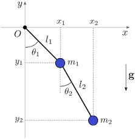

# The Double Pendulum

## 1. Introduction

The double pendulum is a simple mechanical system consisting of two pendulum arms connected in series. Despite its simplicity, its dynamics can exhibit a wide range of behaviors—from predictable oscillations to fully chaotic motion.

This makes it an ideal system to study in the context of **nonlinear dynamics**, **sensitive dependence on initial conditions**, and **chaos theory**.

This lecture provides:
- A theoretical introduction to the double pendulum
- A derivation of the equations of motion
- An explanation of chaotic vs. non-chaotic behavior
- Hands-on exercises
- A full Fortran implementation for numerical integration

---

# 2. Theoretical Background

## 2.1 The double pendulum system

We consider two point masses:
- Masses: $m_1, m_2$
- Rod lengths: $L_1, L_2$
- Angles from the vertical: $\theta_1, \theta_2$

The configuration is fully described by the generalized coordinates:

$$
q = (\theta_1,\theta_2)
$$

## 2.2 Kinetic and potential energy

### Positions:
$$
x_1 = L_1 \sin\theta_1,\quad y_1 = -L_1 \cos\theta_1
$$
$$
x_2 = x_1 + L_2 \sin\theta_2,\quad y_2 = y_1 - L_2 \cos\theta_2
$$

### Velocities:
Obtain by differentiating the above expressions.

### Energies:
$$
\begin{aligned}
T &= \frac{1}{2}m_1 v_1^2 + \frac{1}{2}m_2 v_2^2, \\
V &= m_1 g y_1 + m_2 g y_2.
\end{aligned}
$$

We now make a change of variables to polar coordinates to write:

$$
\begin{aligned}
y_1&=-L_1 \cos(\theta_1),\\
y_2&=-L_1 \cos(\theta_1)-L_2 \cos(\theta_2),\\
v_1&=L_1\dot \theta_1, \\
v_2&=\sqrt{(L_1\dot \theta_1)^2+(L_2\dot \theta_2)^2+2L_1L_2\dot\theta_1\dot\theta_2\cos(\theta_2-\theta_1)}. \\
\end{aligned}
$$

The velocity $v_2$ can be easily obtained by first computing it in the reference frame co-moving with the mass $m_1$ and then going back to the rest frame:

$$
\begin{aligned}
\tilde{\bf v}_2& = L_2\dot\theta_2\hat{\mathbf \theta}_2, \\
{\bf v}_2 &=\tilde{\bf v}_2+L_1\dot\theta_1\hat{
\mathbf \theta}_1, \\
\end{aligned}
$$

where $\hat{\mathbf \theta}_1$ and $\hat{\mathbf \theta}_2$ are the tangent vectors to the trajectories of the mass $m_1$ and $m_2$ in the rest and $m_1$ reference frame respectively.

### Lagrangian:

The Lagrangian is $\mathcal{L} = T - V$:

$$
\begin{aligned}
\mathcal{L} &=
\frac{1}{2}m_1(L_1\dot \theta_1)^2+\frac{1}{2}m_2\left((L_1\dot \theta_1)^2+(L_2\dot \theta_2)^2+2L_1L_2\dot\theta_1\dot\theta_2\cos(\theta_2-\theta_1)\right)\\
&\quad - m_1 g L_1 \cos(\theta_1)-m_2 g \left(L_1 \cos(\theta_1)+L_2 \cos(\theta_2)\right).
\end{aligned}
$$

Note the **minus sign** in front of the potential-energy terms: $\mathcal{L} = T - V$.

### The conserved energy:

Since the Lagrangian has no explicit time dependence, the total energy

$$
\begin{aligned}
E &= T + V \\
&= \frac{1}{2}m_1 L_1^2\dot\theta_1^2
+\frac{1}{2}m_2\left(L_1^2\dot\theta_1^2+L_2^2\dot\theta_2^2+2L_1L_2\dot\theta_1\dot\theta_2\cos(\theta_2-\theta_1)\right)\\
&\quad -(m_1+m_2)gL_1\cos\theta_1 - m_2 g L_2\cos\theta_2
\end{aligned}
$$

is a **constant of motion**. This is the single most useful numerical diagnostic of the whole section: a correct implementation and a good integrator keep $E(t)$ constant (see Exercise 1.1). Note instead that the angular momentum of the second bob, $p_{\theta_2}$, is **not** conserved: the two arms continuously exchange momentum (see Exercise 1.4).

---

## 2.3 Equations of Motion

Using the Euler–Lagrange equations:

$$
\frac{d}{dt}\left(\frac{\partial \mathcal{L}}{\partial \dot\theta_i}\right) - \frac{\partial \mathcal{L}}{\partial \theta_i} = 0
$$

We obtain the two equations:

$$
\begin{aligned}
(m_1+m_2)L_1 \ddot\theta_1+m_2L_2\ddot\theta_2\cos(\theta_2-\theta_1)&=m_2L_2\dot\theta_2^2\sin(\theta_2-\theta_1)-(m_1+m_2)g\sin(\theta_1)\\
L_2 \ddot \theta_2+L_1\ddot \theta_1\cos(\theta_2-\theta_1)&=-L_1\dot\theta_1^2\sin(\theta_2-\theta_1)-g\sin(\theta_2),
\end{aligned}
$$

which can be used to derive the following equations:

$$
\begin{aligned}
\ddot\theta_1&=\frac{m_2L_1\dot\theta_1^2\sin(2\theta_2-2\theta_1)/2+m_2L_2\dot\theta_2^2\sin(\theta_2-\theta_1)+m_2g\sin(\theta_2)\cos(\theta_2-\theta_1)-(m_1+m_2)g\sin(\theta_1)}{L_1\left((m_1+m_2)-m_2\cos^2(\theta_2-\theta_1)\right) }\\
\ddot \theta_2&=\frac{1}{L_2}\left(-L_1\ddot \theta_1\cos(\theta_2-\theta_1)-L_1\dot\theta_1^2\sin(\theta_2-\theta_1)-g\sin(\theta_2)\right),
\end{aligned}
$$

This nonlinear, coupled system shows chaotic behavior at sufficiently high energy.

---

## 2.4 The small-angle limit: normal modes

Before diving into chaos, it is worth checking that the equations reduce to something familiar when the angles are small. For $m_1=m_2=m$, $L_1=L_2=L$, and $|\theta_i| \ll 1$ we linearize ($\sin\theta\approx\theta$, $\cos\theta\approx 1$, and drop products of small quantities). The two equations decouple into two **independent normal modes**:

$$
\theta_1 = \theta_2 \quad \text{(in-phase)}, \qquad \theta_1 = -\theta_2 \quad \text{(anti-phase)},
$$

with angular frequencies

$$
\omega_\pm = \omega_0\sqrt{2 \pm \sqrt{2}}, \qquad \omega_0 = \sqrt{g/L}.
$$

So at low energy the double pendulum is nothing but a pair of **coupled harmonic oscillators** — the same system you know from the theory of small oscillations. Chaos appears only when the nonlinear terms (the $\sin(\theta_2-\theta_1)$ couplings) become important, i.e. at large amplitude. Measuring these two frequencies numerically is a stringent test that the equations of motion (not just the integrator) are correct (see Exercise 1.2).

---

# 3. Chaos in the Double Pendulum

## 3.1 Sensitive Dependence on Initial Conditions

A hallmark of chaos:
- Tiny perturbations in initial angles/velocities lead to very different trajectories.
- At small amplitude, the motion is regular and nearly periodic.
- At high energy, the second arm can rotate fully, triggering chaotic dynamics.

The sensitivity is quantified by the **largest Lyapunov exponent** $\lambda$. Take two trajectories that start a distance $d(0)$ apart in phase space, and follow their separation $d(t)$:

$$
\lambda = \lim_{t\to\infty}\lim_{d(0)\to 0}\; \frac{1}{t}\,\ln\frac{d(t)}{d(0)}.
$$

- $\lambda = 0$: regular motion — nearby trajectories stay close.
- $\lambda > 0$: **chaos** — separations grow exponentially, $d(t)\sim d(0)e^{\lambda t}$.

The exponential growth cannot continue forever (the accessible phase space is bounded by the energy), so $d(t)$ eventually saturates; $\lambda$ must be extracted from the intermediate, exponential-growth window (see Exercise 2.2). The inverse $1/\lambda$ sets the time beyond which any prediction becomes impossible — this is the precise meaning of "unpredictable".

## 3.2 Phase space structure

The system has:
- Regular, smooth trajectories at low energy
- Fractal-like separatrices at moderate energy
- Fully chaotic regions at high energy

Because the conserved energy confines the motion to a three-dimensional surface inside the four-dimensional phase space, the cleanest way to *see* this structure is a **Poincaré section**: record the state of the system only when $\theta_1$ crosses zero (in a fixed direction, say upward), and plot the crossing points in the $(\theta_2, \omega_2)$ plane. Each trajectory then draws:

- a smooth closed curve, if the motion is quasi-periodic — the trace of an invariant torus (a "KAM torus");
- a scattered cloud of points, if the motion is chaotic — a slice of the "chaotic sea".

Superposing sections from many initial conditions at the same energy reveals, in a single figure, the coexistence of regular islands and chaotic layers, and how the chaotic component grows with energy. This provides a natural way to study the transition between order and chaos (see Exercise 3.2 and 3.3).

---

## 3.3 Why the double pendulum matters: modeling real systems

The double pendulum is more than a textbook curiosity: it is the minimal mechanical system that is both **nonlinear and chaotic**, which makes it the standard "toy model" for any real system with two coupled, nonlinear degrees of freedom.

**Physics and engineering.**
- **Robotics and robot arms.** A two-link manipulator is literally a driven double pendulum; trajectory planning and control (e.g. the swing-up of the "Acrobot") must confront the same sensitivity to initial conditions.
- **Cranes and cargo handling.** A payload hanging from a boom behaves as a (driven) double pendulum — the basis of anti-sway control in ports and construction.
- **Biomechanics of locomotion.** The human leg during the swing phase of walking is well approximated by a double pendulum: thigh + shank, with hip and knee as the two joints. The same model describes the swinging arm, and in sports science the golf club or a gymnast on a bar.
- **Energy harvesting.** Wave-energy converters and vibration-energy harvesters are often designed as driven pendula: their performance relies precisely on chaotic, wide-amplitude response to irregular forcing.

**Beyond physics.**
- **Biology.** Two coupled nonlinear oscillators with feedback appear in motor control of limb joints and, at the molecular scale, in the dynamics of polymer/DNA chain segments under flow, each link behaving as a coupled pendulum.
- **Finance and time-series analysis.** The double pendulum is the standard **chaotic test bed** for forecasting methods: because it generates deterministic but unpredictable data, it is used to test machine-learning models before applying them to markets, where one suspects chaos but cannot prove it. A model that cannot predict the double pendulum beyond the Lyapunov time has no hope on a financial time series.
- **Machine learning and AI.** It is one of the most common benchmark systems for physics-informed neural networks, model discovery (SINDy), and reinforcement-learning control — cheap to simulate, hard to predict.

The lesson to carry away: **wherever two nonlinear degrees of freedom are coupled — mechanical, biological, or economic — the qualitative phenomenology you are about to simulate (regular islands, separatrix chaos, unpredictability) is already present in the double pendulum.** See Exercise 4.5: find a double-pendulum model in your own field.

---

# 4. Numerical Integration

We rewrite the system as first-order ODEs:

$$
\dot\theta_1 = \omega_1,\quad \dot\theta_2 = \omega_2
$$
$$
\dot\omega_1 = f_1(\theta_1,\theta_2,\omega_1,\omega_2)
$$
$$
\dot\omega_2 = f_2(\theta_1,\theta_2,\omega_1,\omega_2)
$$

A 4th-order Runge–Kutta (RK4) integrator is used. Starting from the state $y_n$ at time $t_n$, one step of size $\Delta t$ computes four slopes

$$
k_1 = f(y_n),\quad
k_2 = f\left(y_n + \tfrac{\Delta t}{2}k_1\right),\quad
k_3 = f\left(y_n + \tfrac{\Delta t}{2}k_2\right),\quad
k_4 = f\left(y_n + \Delta t\,k_3\right),
$$

and combines them

$$
y_{n+1} = y_n + \frac{\Delta t}{6}\left(k_1 + 2k_2 + 2k_3 + k_4\right).
$$

The local error of one step is $O(\Delta t^5)$, so the global error is $O(\Delta t^4)$: halving $\Delta t$ should reduce the energy drift of a conservative system by a factor $\sim 16$. This is exactly what you will verify in Exercise 1.1, and it is the signature that separates a genuine 4th-order scheme from a lower-order one. The RK4 formulas map one-to-one onto the `rk4_step` function of the Fortran code, which reads its parameters from a namelist input file (see the code header for the format).
